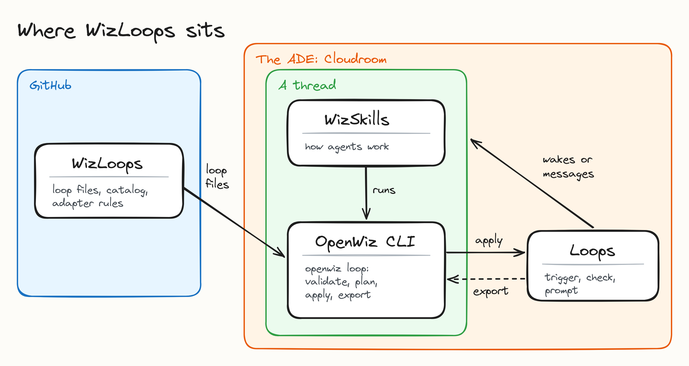

# WizLoops

Loops for coding agents, as files: one Markdown file per loop, for any agent
workspace (an ADE), Cloudroom first.

A **loop** is an alarm clock for an agent: a trigger wakes it, an optional
check decides whether there is work, and an agent gets the prompt. Most ADEs
keep loops only in their settings, where you can't review, copy or diff them.
WizLoops keeps each one as a file you change by pull request.



WizLoops holds the format, the catalog and the adapter rules, and no code.
The OpenWiz CLI (`openwizdev/OpenWiz`) reads the files and drives the ADE;
WizSkills, OpenWiz's skills, are what an agent's thread runs, and the loops
wake or message that thread.

## A loop file

Frontmatter for the settings, the body for the prompt:

```markdown
---
id: "review-nudge"
name: "Review nudge"
trigger: {"cron": "0 9 * * 1-5", "timezone": "UTC"}
check: {"run": "review-nudge/check.sh", "timeout": 60}
thread: "same"
priority: 2
params: {"repo": "example-org/example-repo"}
---
The check printed the pull requests in {{repo}} still waiting for a review.
Ask for a review on each one, once.
```

- **One `key: value` per line,** each value one JSON value. It reads as YAML
  but needs no YAML library.
- **`trigger`** is exactly one of a cron with a timezone, a one-off `at`
  time, an `in` delay or a `webhook`.
- **`check`** runs first. If it prints nothing, the wake is quiet and no
  agent starts, so a quiet wake costs no tokens.
- **`thread`** is `"same"` (prompt the thread that applied the loop again)
  or `"new"` (a fresh thread each run).
- **`secrets`** default to `[]`: the loop grants no secrets. On a
  `"new"`-thread loop, the run and its check get only the secrets it names.
  On a `"same"`-thread loop, like the example above, the run and its check
  keep whatever the thread already has, so `secrets` limits nothing there.
- **`params`** fill `{{name}}` placeholders in the prompt and the check.

The whole contract, with every field, refusal and fixture:
[`format/loop.v1.md`](format/loop.v1.md).

## The catalog

Five starter loops, each generalized from a loop that runs a real software
factory, with every name and place as a param and no secret grants unless
one is named. They are being added in 0.1.0; see [`catalog/`](catalog/README.md).

| id | What it does |
| --- | --- |
| `fleet-check` | Wakes a fleet's manager only when its spec has something due |
| `hourly-status` | Posts an hourly status line, only when something changed |
| `morning-digest` | Sends the owner a daily digest at a fixed local time |
| `stall-sweep` | Finds work waiting with no progress, and says why |
| `workflow-kick` | Starts a CI workflow on time from its check alone; no agent ever starts |

## `openwiz loop` with Cloudroom

Four commands in the OpenWiz CLI read these files. They are planned for
OpenWiz 0.0.17 and have not shipped yet; their exact arguments and JSON
results will be in OpenWiz's loop CLI contract.

| Command | What it does |
| --- | --- |
| `openwiz loop validate <files>` | Checks each file against the format and names every problem by file and field |
| `openwiz loop plan <files>` | A dry run: prints the exact `room-cli loop` commands and the difference from the live loops, and changes nothing |
| `openwiz loop apply <id>` | Creates or updates one loop with its plan's commands, then reads it back |
| `openwiz loop export` | Writes one file per live loop from `room-cli loop list` |

How each field maps to Cloudroom and back is in the
[Cloudroom adapter rules](adapters/cloudroom.v1.md). The adapter never
changes a loop silently: what Cloudroom can't do exactly, it refuses and
names the field. For example, Cloudroom runs a check for exactly 60
seconds, so any other `check.timeout` is refused, and a loop without a check
may run at most every 15 minutes.

## The adapter rule

**A loop must be able to wake or message the orchestrator:** a run either
prompts the orchestrator's own thread again or can send it a message. An ADE
that can do neither gets no adapter. There is no GitHub Actions fallback.

## Not supported yet

- **The commands themselves:** `openwiz loop` is planned for OpenWiz 0.0.17.
  Until it ships, nothing reads these files for you.
- **CI validation:** checking every catalog file and fixture with
  `openwiz loop validate` in CI comes later in 0.1.0.
- **Other ADEs:** Cloudroom is the only adapter. None yet for Claude Code,
  Codex or Cursor, and no local fallback timer.
- **In the Cloudroom adapter (v1):** no deleting loops; no changing a loop's
  thread kind, or to or from a webhook; no removing a check or an agent from
  an existing loop. Each is refused, never faked.
- **In the format (v1):** no budgets, no shadow mode and no in-file
  approval (the pull request that adds a file approves it), and no escape
  for a literal `{{`.

## Licence

Licensed under the Apache License 2.0 (`LICENSE`).
